<div align="center">

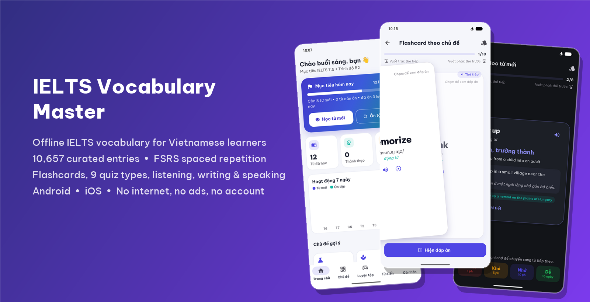

# IELTS Vocabulary Master

**A fully offline IELTS vocabulary app for Vietnamese learners, from B2 up to an IELTS 7.5+ target.**

[](https://github.com/COngtuthien/English-app/actions/workflows/android-apk.yml)
[](https://github.com/COngtuthien/English-app/actions/workflows/ios.yml)


[Features](#-features) ·
[Screenshots](#-screenshots) ·
[Vocabulary data](#-vocabulary-data) ·
[Getting started](#-getting-started) ·
[Architecture](#-architecture) ·
[Testing](#-testing) ·
[Licence](#-licence--attribution) ·
[Changelog](CHANGELOG.md)

</div>

---

## ✨ Overview

IELTS Vocabulary Master helps Vietnamese learners build the vocabulary they need for IELTS:
academic words, collocations, phrasal verbs, idioms and the expressions used in Writing and Speaking.
Every entry has a Vietnamese meaning, an English definition, pronunciation and at least one example
sentence. A spaced-repetition scheduler (FSRS) decides what to review and when.

The app works **entirely on the device**. It has no account, no ads, no analytics and no network
permission. The 10,657-entry dictionary ships inside the app, and pronunciation uses the phone's
built-in offline text-to-speech voices.

| | |
|---|---|
| 📚 **10,657 curated entries** | Words, phrasal verbs, idioms, collocations, Writing & Speaking expressions |
| 🧠 **FSRS spaced repetition** | The modern FSRS-6 algorithm with short learning steps for new words |
| 🃏 **Swipeable flashcards** | Four card modes, tap to reveal, swipe through the deck |
| 📝 **9 quiz types** | Plus a mixed test, matching, typing, listening, writing and speaking practice |
| 🗂️ **50 IELTS topics** | Education, Environment, Technology, Health, Globalisation and more |
| 📴 **100 % offline** | No internet permission on Android, no ATS exceptions on iOS |

---

## 🚀 Features

### Learning
- **Daily plan**: a daily goal for new words and a review queue from the FSRS scheduler (learning steps of 1 and 10 minutes, then days or weeks).
- **Flashcards** in four modes: English → Vietnamese, Vietnamese → English, definition → word and cloze (fill the gap).
- **Card gestures**:

  | Gesture | Action |
  |---|---|
  | Tap the card or **“Hiện đáp án”** | Reveal / hide the answer |
  | Swipe **left** | Next card |
  | Swipe **right** | Previous card |
  | **Quên / Khó / Nhớ / Dễ** (Again / Hard / Good / Easy) | Grade the card, save the review and move on |

  The card follows your finger with a slight tilt, then flies off with a light spin while the next card rises from the deck. A short drag springs back.
- **Choose the session size** before topic lessons, topic flashcards, quizzes, random cards, difficult-word reviews and favourites (presets, a custom number, or *all*).
- **Topic study**: 50 IELTS topics plus skill groups (Academic English, Writing Task 1 & 2, Speaking, Listening phrases, phrasal verbs, idioms, collocations, confusable words).

### Practice
- **Vocabulary quiz**: English → Vietnamese, Vietnamese → English, fill in the blank, spelling, definition matching, synonyms, antonyms, collocations and IELTS context, plus a mixed test of all nine.
- **Matching game**, **typing practice** (active recall and spelling) and **listening practice** (hear a word and recognise it).
- **Writing**: 141 vocabulary exercises for Task 1 (describing charts) and Task 2 (opinion essays).
- **Speaking**: 24 phrase packs for Parts 1, 2 and 3.

### Dictionary
- Search in **English or Vietnamese, with or without diacritics** (`moi truong` finds *environment*), backed by SQLite full-text search.
- Word pages with UK/US IPA, offline pronunciation (normal and slow), Vietnamese meanings, definitions, examples with translations, collocations, synonyms/antonyms and word families.
- Favourites, difficult words, recently studied words and words you got wrong.

### Progress
- Home dashboard: today's goal, streak, words learned, words mastered and 7-day activity.
- Statistics: a 30-day activity chart, retention and the distribution of your grades.
- 12 achievements, a study calendar and a local daily reminder notification.

### Personalisation & data
- Current level, target band, new words per day, review limit, new-word level range, study order, preferred topics, default card mode, UK/US accent and speech rate.
- Light, dark and system themes.
- **Backup & restore** to a JSON file, validated before restoring. On iOS the file is also visible in the Files app.

---

## 📱 Screenshots

> Captured on an Android emulator. The iOS build uses the same Flutter UI.

<table>
  <tr>
    <td align="center">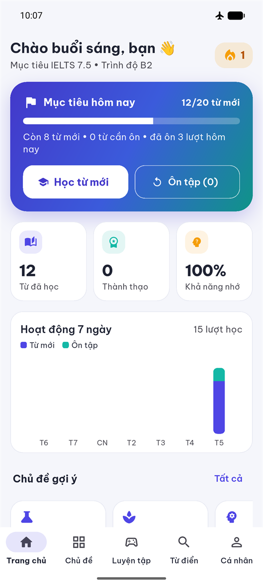<br/><sub><b>Home</b></sub></td>
    <td align="center">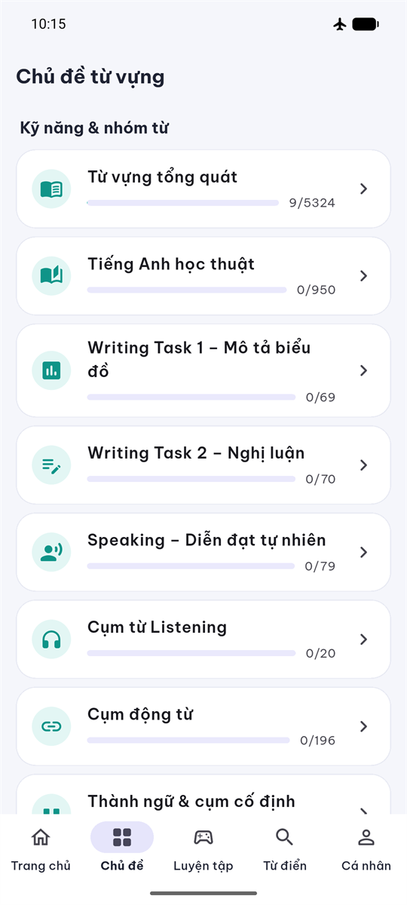<br/><sub><b>Topics & skills</b></sub></td>
    <td align="center">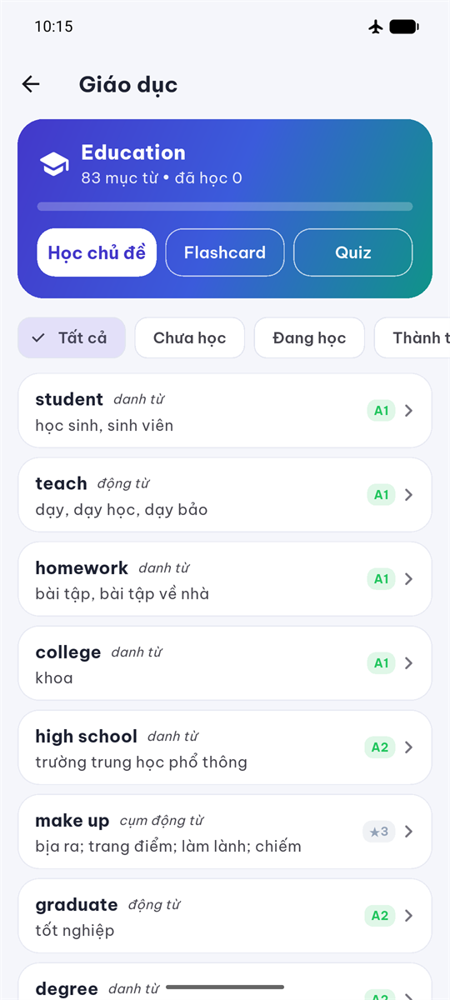<br/><sub><b>Topic: Education</b></sub></td>
    <td align="center">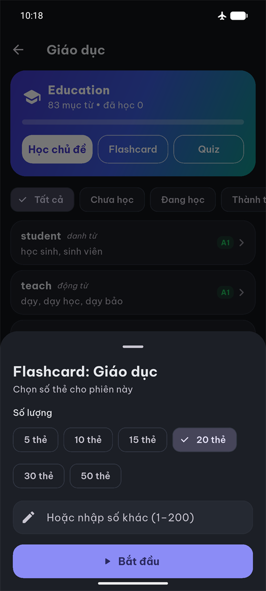<br/><sub><b>Choose session size</b></sub></td>
  </tr>
  <tr>
    <td align="center">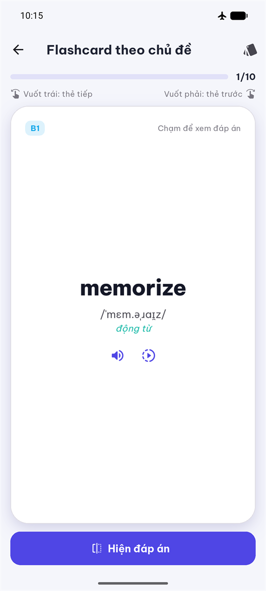<br/><sub><b>Flashcard (front)</b></sub></td>
    <td align="center">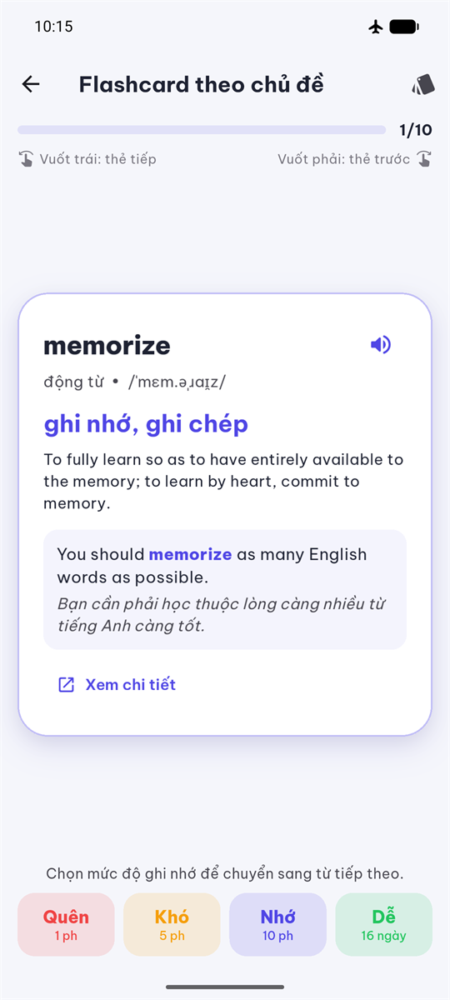<br/><sub><b>Answer & grading</b></sub></td>
    <td align="center">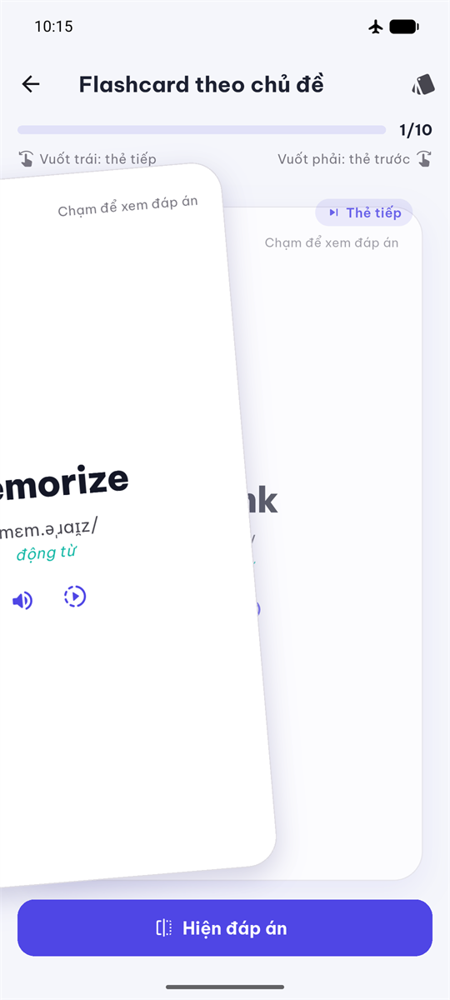<br/><sub><b>Swipe to the next card</b></sub></td>
    <td align="center">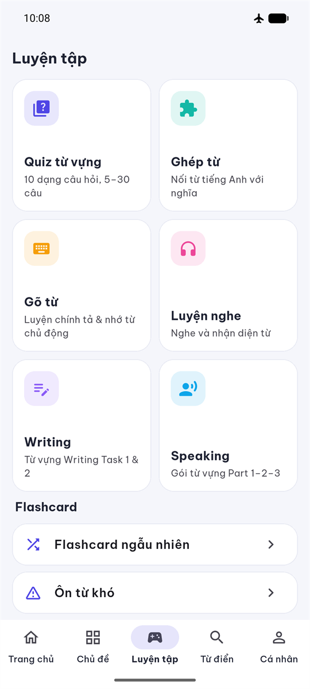<br/><sub><b>Practice hub</b></sub></td>
  </tr>
  <tr>
    <td align="center">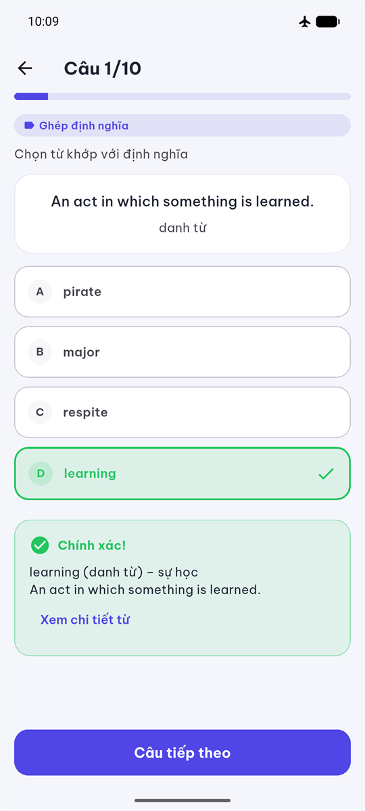<br/><sub><b>Quiz</b></sub></td>
    <td align="center">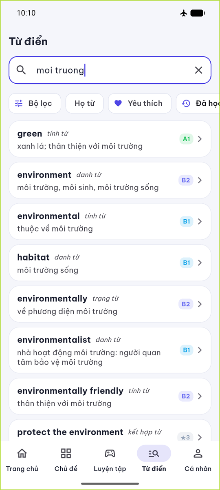<br/><sub><b>Dictionary search</b></sub></td>
    <td align="center">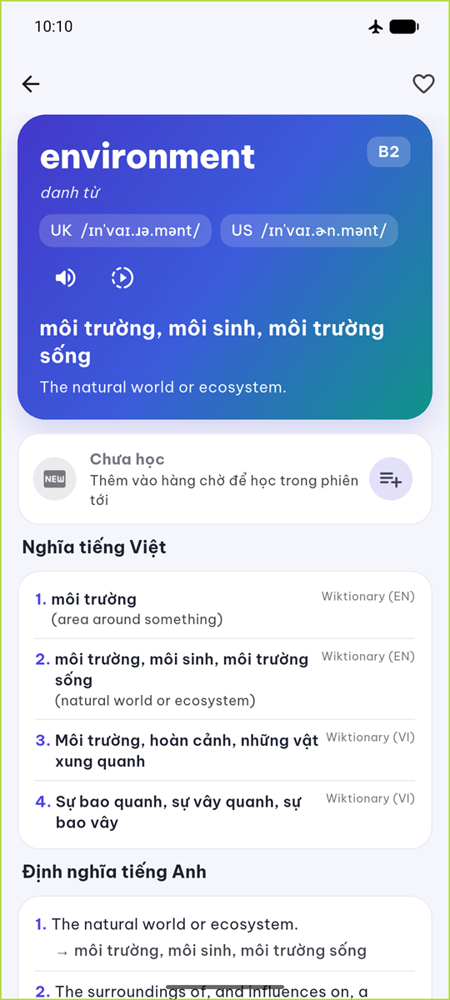<br/><sub><b>Word details</b></sub></td>
    <td align="center">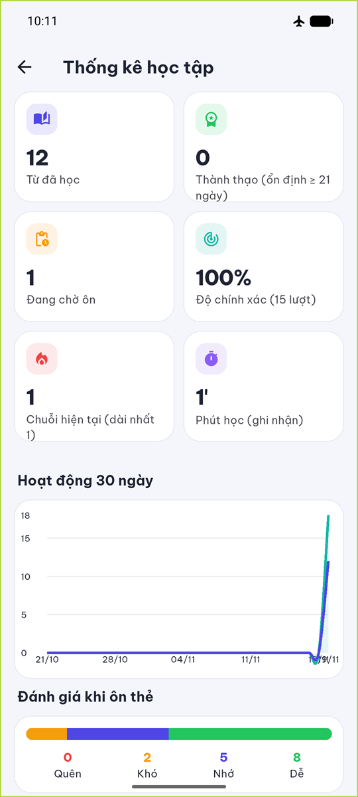<br/><sub><b>Statistics</b></sub></td>
  </tr>
  <tr>
    <td align="center">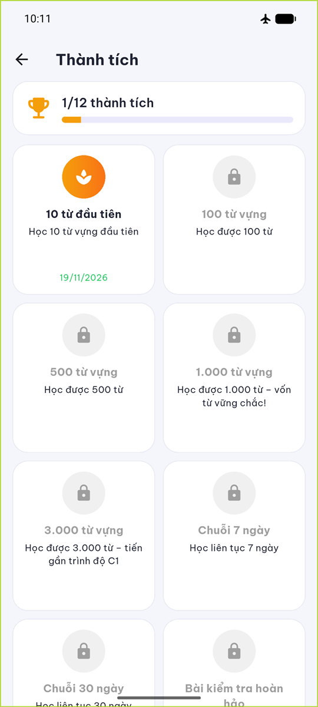<br/><sub><b>Achievements</b></sub></td>
    <td align="center">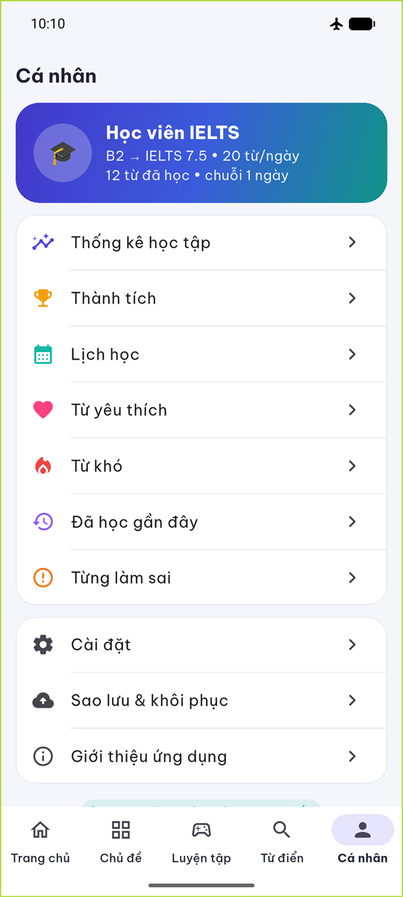<br/><sub><b>Profile</b></sub></td>
    <td align="center">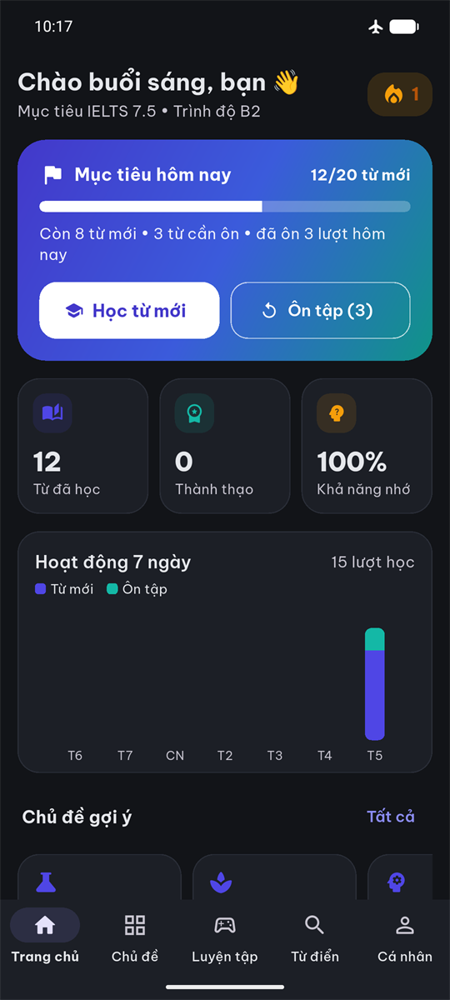<br/><sub><b>Dark mode</b></sub></td>
    <td align="center">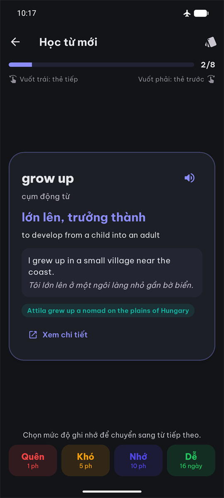<br/><sub><b>Dark flashcard</b></sub></td>
  </tr>
</table>

---

## 📖 Vocabulary data

The database (`assets/db/vocab.db`, about 33 MB) is built from open datasets by
`tools/data/build_database.py` and checked by `tools/data/validate_database.py` (13 checks; the
build fails on any error). Every row records where it came from.

| Content | Count |
|---|---|
| Validated entries (words, phrasal verbs, idioms, collocations, expressions) | **10,657** |
| IELTS topics | 50 |
| Writing exercises (Task 1 & 2) | 141 |
| Speaking phrase packs (Parts 1–3) | 24 |

| Source | Licence | Used for |
|---|---|---|
| English Wiktionary (via Wiktextract / kaikki.org) | CC BY-SA 4.0 | Definitions, examples, IPA, synonyms/antonyms, related terms |
| Vietnamese Wiktionary (via Wiktextract) | CC BY-SA 4.0 | Vietnamese meanings, phrase examples |
| Tatoeba | CC BY 2.0 FR | Example sentences with human Vietnamese translations |
| CEFR-J Wordlist 1.5 / Octanove C1–C2 | Citation / CC BY-SA 4.0 | Headwords and CEFR levels |
| NAWL 1.2 / NGSL 1.2 | CC BY-SA 4.0 | Academic headwords, frequency ranks |
| ipa-dict | MIT | Fallback UK/US IPA |
| Curated IELTS content (this repo, `tools/data/curated/`) | CC BY-SA 4.0 | Writing/Speaking expressions, collocations, exercises, topic taxonomy |

No commercial dictionary content, machine translation or AI-generated definitions were used.
Full details, citations and download dates are in [`DATASET_SOURCES.md`](DATASET_SOURCES.md), and the
quality report is in [`release/VOCABULARY_REPORT.md`](release/VOCABULARY_REPORT.md).

---

## 🛠️ Getting started

### Requirements

| | Version |
|---|---|
| Flutter / Dart | 3.41.4 / 3.11 |
| Android | JDK 21, Android SDK 36; devices running Android 7.0 (API 24) or later |
| iOS | macOS with Xcode 16+ and CocoaPods; devices running iOS 14.0 or later |

```bash
git clone https://github.com/COngtuthien/English-app.git
cd English-app
flutter pub get
flutter run            # pick an Android device/emulator or an iOS simulator
```

### Android

```powershell
# Windows: installs/checks Flutter, JDK 21, the Android SDK and a local signing key
powershell -ExecutionPolicy Bypass -File scripts\setup_environment.ps1

# validate data → analyze → test → build → verify signature → copy to release/ + SHA-256
powershell -ExecutionPolicy Bypass -File scripts\build_release.ps1
```

On Linux or macOS use `scripts/build_release.sh`. Release signing reads `android/key.properties`,
which is git-ignored and never committed. Without it, the build is debug-signed.

### iOS

iOS builds need a Mac:

```bash
flutter build ios --release          # or open ios/Runner.xcworkspace in Xcode
```

1. Open `ios/Runner.xcworkspace` in Xcode and choose your **Team** under *Signing & Capabilities*. The bundle ID is `com.ieltsvocabulary.master`; change it if it is already taken in your account.
2. Connect an iPhone and press **Run**, or use *Product → Archive* for TestFlight or the App Store.

**No Mac?** The [**Build iOS** workflow](https://github.com/COngtuthien/English-app/actions/workflows/ios.yml)
builds an **unsigned `.ipa`** on every push (artifact *IELTS_Vocabulary_Master-ios-unsigned*).
You can sign and install it with a tool such as Sideloadly or AltStore and a free Apple ID. Apps
signed with a free Apple ID expire after 7 days and must be re-signed; a paid Apple Developer
account removes that limit.

<details>
<summary><b>iOS-specific notes</b></summary>

- Minimum iOS **14.0**, because `file_picker` requires it. Portrait only; full screen on iPad.
- Pronunciation uses the on-device `AVSpeechSynthesizer` voices through a *playback* audio session, so words are audible even with the silent switch on.
- The daily reminder is a local notification. Permission is requested only when you turn the reminder on.
- Backups are saved through the system document picker. `UIFileSharingEnabled` also exposes the app folder in the Files app.
- No network entitlements and no App Transport Security exceptions.

</details>

### Rebuilding the vocabulary database (optional)

```powershell
scripts\validate_vocabulary.ps1 -Rebuild   # downloads ~3.7 GB of open data into data_sources/ (git-ignored)
```

After changing the data, bump `CONTENT_VERSION` in `tools/data/build_database.py` **and**
`kContentVersion` in `lib/data/db/app_database.dart` so installed apps update their copy.

---

## 🏗️ Architecture

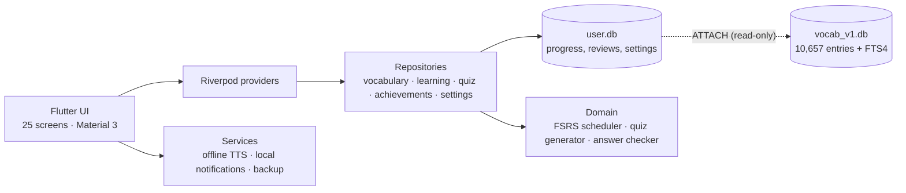

- **State**: Riverpod 2. **Navigation**: GoRouter with a 5-tab `StatefulShellRoute`.
- **Storage**: `sqflite`. The read-only content database is copied from the app bundle on first launch and `ATTACH`ed to the user database, so one SQL query can join content with progress.
- **Search**: SQLite FTS4 with accent-insensitive Vietnamese matching and relevance ranking.
- **Scheduling**: [`fsrs`](https://pub.dev/packages/fsrs) (FSRS-6), with UTC timestamps.
- **Flashcard sessions**: a pure-Dart controller (`FlashcardSession`) owns navigation and grading, so the rules are unit-tested. Reviews are saved in order in the background, so the UI never waits for the database.

<details>
<summary><b>Project structure</b></summary>

```
lib/
├── app.dart                # routes (GoRouter) and theme wiring
├── main.dart               # bootstrap: database copy/attach, settings
├── providers.dart          # Riverpod providers
├── core/                   # theme, shared widgets, Vietnamese text utilities
├── data/
│   ├── db/                 # database open/attach/migrations
│   ├── models/
│   ├── repositories/       # vocabulary, learning (FSRS), quiz, achievements, settings
│   └── services/           # TTS, notifications, backup
├── domain/                 # FSRS scheduler wrapper, quiz generation, answer checking
└── features/               # one folder per screen group (home, learn, quiz, dictionary, …)
android/  ios/              # platform projects
assets/db/vocab.db          # bundled vocabulary database
tools/data/                 # dataset download, build and validation scripts + curated JSON
scripts/                    # setup, build, test and data scripts (PowerShell + bash)
test/  integration_test/    # unit, database, widget and end-to-end tests
```

More detail: [`ARCHITECTURE.md`](ARCHITECTURE.md).

</details>

---

## ✅ Testing

```bash
flutter analyze
flutter test                                              # unit + database + widget tests
flutter test integration_test/app_test.dart -d <device>   # end-to-end on a phone, emulator or simulator
```

- **Host tests** (90 passing): the FSRS scheduler, the flashcard session controller (navigation, grading, requeue rules), repositories against the real bundled database, Vietnamese search, the quiz generator, the count picker and the flashcard screen (tap, swipe, grade, summary).
- **Integration test**: onboarding, copying the database, FTS search with the platform's SQLite, studying flashcards (reveal, swipe back and forward, grade), dictionary search, persistence across restarts, a quiz, and backup/restore. It runs in airplane mode on Android and on an iPhone simulator in CI.

### Continuous integration

| Workflow | Runner | What it does |
|---|---|---|
| [Build Android APK](.github/workflows/android-apk.yml) | Ubuntu | Validate data → analyze → test → release APK (signed when the keystore secrets are set) → check that there is no `INTERNET` permission → upload the APK |
| [Build iOS](.github/workflows/ios.yml) | macOS | Release build without code signing → verify the bundle → upload an unsigned IPA; integration test on an iPhone simulator |

---

## 🔒 Privacy

- No account, no ads, no analytics, no crash reporting.
- The Android app has **no `INTERNET` permission**. The iOS app has no network entitlements.
- All progress stays in the app's local database. Backups are plain JSON files that you save yourself.

---

## 🗺️ Roadmap

- More curated Vietnamese meanings for B2–C1 words whose open-data gloss is weak.
- More example sentences with Vietnamese translations (currently 42.7 % of entries).
- Larger thin topics (Globalisation, Migration, Population, Urbanisation).
- Licensed human pronunciation audio as an alternative to device TTS.

---

## 📄 Licence & attribution

- **Vocabulary database**: CC BY-SA 4.0. It contains CC BY-SA material from Wiktionary, Octanove, NAWL and NGSL; CC BY 2.0 FR material from Tatoeba; CEFR-J levels used with citation; and ipa-dict (MIT). See [`DATASET_SOURCES.md`](DATASET_SOURCES.md) for the required citations. The app's *About* screen lists every source.
- **Font**: [Be Vietnam Pro](https://fonts.google.com/specimen/Be+Vietnam+Pro), SIL Open Font License 1.1.
- **App source code**: all rights reserved by the repository owner unless stated otherwise.

<div align="center">
<sub>Made with Flutter for Vietnamese IELTS learners · Hướng dẫn cài đặt tiếng Việt: <a href="release/INSTALL_GUIDE_VI.md">release/INSTALL_GUIDE_VI.md</a></sub>
</div>
